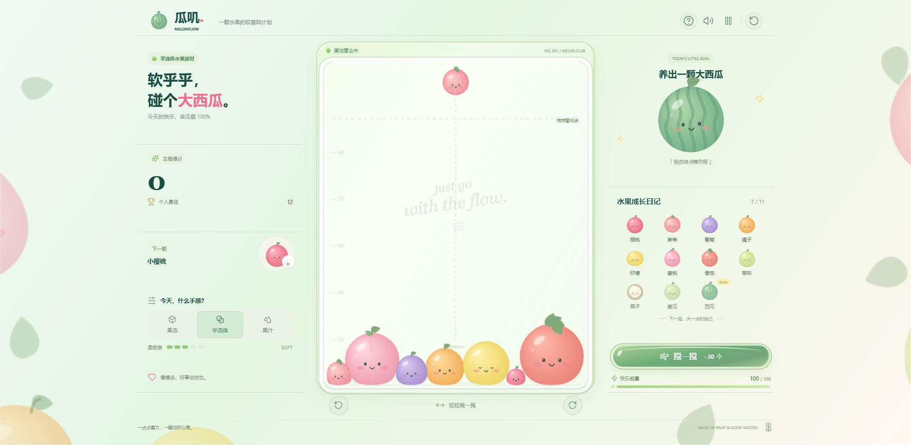

# 瓜叽 MelonFlow

直接双击 **MelonFlow.html** 即可开始。游戏、物理引擎、插画和图标全部包含在这个文件里，无需联网或安装。

- 鼠标移动瞄准，点击投放；手机拖动瞄准，松手投放。
- 相同水果碰撞合成，连续合成有分数加成。两颗大西瓜融合后消失并奖励分数。
- 三种物态改变弹簧刚度、阻尼和回弹。水果由独立碰撞节点、弹簧和体积压力组成。
- 果池里的水果只能通过碰撞、重力、倾斜和搅动移动，鼠标与触屏拖动只用于瞄准，松手投放。
- 按住左右按钮倾斜；搅动消耗 30 能量，能量会自动恢复。
- 水果持续超过警戒线 3 秒后结束。本地保留最高分，24 小时内可恢复未结束的游戏。
- 键盘：方向键瞄准，Enter 投放，A/D 倾斜，空格搅动，P 暂停。
- 音效默认开启：投放是短促气泡声，合成是清脆上扬音。右上角喇叭可静音，设置会保存。

## 得分规则

投放水果本身不加分。两颗相同水果合成时，按**合成后的水果**计算基础分；连续合成再乘以连合倍率：`本次得分 = 基础分 × min(连续合成次数, 5)`。

| 合成结果 | 基础分 | 回能 |
| --- | ---: | ---: |
| 草莓 | 6 | 5 |
| 葡萄 | 12 | 6 |
| 橘子 | 20 | 7 |
| 柠檬 | 30 | 8 |
| 蜜桃 | 42 | 9 |
| 番茄 | 56 | 10 |
| 雪梨 | 72 | 11 |
| 椰子 | 90 | 12 |
| 蜜瓜 | 110 | 13 |
| 西瓜 | 132 | 14 |
| 两颗西瓜融合（消失） | 1500 | 14 |

相邻两次合成间隔**少于 1.8 秒游戏时间**，连合次数就加 1；间隔达到 1.8 秒则重新从 1 倍计算。倍率最高 5 倍。例如两颗草莓合成葡萄，首次得 12 分；若上一笔合成后不到 1.8 秒又合出一颗葡萄，第二次得 `12 × 2 = 24` 分。个人最佳分数保存在本机浏览器中。

## 快乐能量

每局初始能量为 **100**，上限也是 **100**。游戏运行时自动恢复 **1.5 点/游戏秒**；暂停或结束时不恢复。每次合成额外获得表中的回能值，超过 100 的部分不累计。回能公式是 `4 + 合成结果的等级`（草莓为 1 级，西瓜为 10 级），两颗西瓜融合时同样回 14 点。

点击「搅一搅」消耗 **30** 点能量；能量不足 30、游戏暂停或结束时不能使用。不合成时，从 0 点自然恢复到可搅动的 30 点约需 20 游戏秒。界面显示的能量数值向下取整。

源文件入口为 `index.html`。修改后执行 `node build.mjs` 重新生成独立 HTML，执行 `node check-game.mjs` 检查离线包内容。

物理引擎：Matter.js 0.20.0（MIT）。图标：Lucide 0.468.0（ISC）。水果造型为本项目 Canvas 原创绘制。依赖的授权说明保留在 `vendor/` 内。
